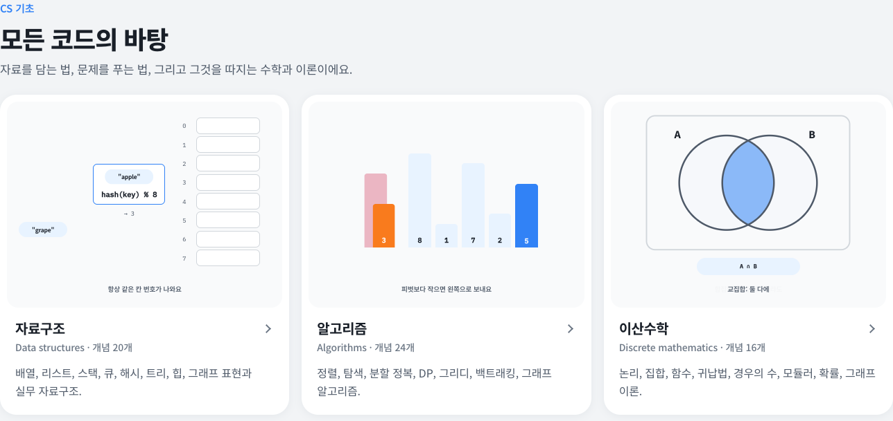

<div align="center">

<a href="https://starrykss.github.io/CS_Study/">
<picture>
  <source media="(prefers-color-scheme: dark)" srcset="assets/preview-dark.png">
  
</picture>
</a>

# 개발자 지식 도감 · Developer Atlas

코드 뒤의 원리를 움직임으로 봐요

컴퓨터공학 전공 과목과 기초 수학·과학, 현업에서 매일 쓰는 지식을 도감 26개로 나누고,<br>개념마다 직접 움직이는 예시를 붙였어요.

<a href="#도감-목록"></a> <a href="#도감-목록"></a> <a href="#이렇게-볼-수-있어요"></a> <a href="https://starrykss.github.io/CS_Study/"></a> <a href="https://github.com/starrykss"></a>

<br>

<a href="https://starrykss.github.io/CS_Study/"></a>

</div>

---

## 통합 포털

**[https://starrykss.github.io/CS_Study/](https://starrykss.github.io/CS_Study/)**

포털에는 도감 26개가 분야별 카드로 놓여 있어요. 카드마다 그 과목의 대표 개념이 움직이고 있고, 카드를 누르면 해당 도감 페이지로 이동해요. 도감 페이지에서는 주제별로 나뉜 개념 카드를 보면서 검색하거나 크게 열어 볼 수 있어요.

```
통합 포털  →  도감 카드 선택  →  과목 페이지 (주제별 개념 카드)  →  카드를 눌러 크게 보기
```

## 도감 목록

과목 25개와 UI/UX 도감, 개념 977개예요. **바로가기**는 웹 페이지, **폴더**는 이 저장소의 내용(개념 설명을 글로 정리한 README 포함)이에요.

### 디자인 · Design

컴포넌트, 제스처, 디자인 스타일, 심리, 플랫폼별 가이드라인과 애니메이션까지 모은 UI/UX 모션 도감이에요.

| 도감 | 다루는 내용 | 개념 | 바로가기 | 폴더 |
| --- | --- | ---: | :---: | --- |
| **UI/UX 모션 도감**<br><sub>UI/UX Motion Atlas</sub> | 컴포넌트, 제스처, 디자인 스타일, UX 라이팅, 심리, iOS·안드로이드, 애니메이션 타이밍, UI 용어 | 393 | [열기](https://starrykss.github.io/CS_Study/ui-ux/) | [`ui-ux/`](./ui-ux) |

### CS 기초 · CS foundations

자료를 담는 법, 문제를 푸는 법, 그리고 그것을 따지는 수학과 이론이에요.

| 도감 | 다루는 내용 | 개념 | 바로가기 | 폴더 |
| --- | --- | ---: | :---: | --- |
| **자료구조**<br><sub>Data structures</sub> | 배열, 리스트, 스택, 큐, 해시, 트리, 힙, 그래프 표현과 실무 자료구조 | 20 | [열기](https://starrykss.github.io/CS_Study/data-structures/) | [`data-structures/`](./data-structures) |
| **알고리즘**<br><sub>Algorithms</sub> | 정렬, 탐색, 분할 정복, DP, 그리디, 백트래킹, 그래프 알고리즘 | 24 | [열기](https://starrykss.github.io/CS_Study/algorithms/) | [`algorithms/`](./algorithms) |
| **이산수학**<br><sub>Discrete mathematics</sub> | 논리, 집합, 함수, 귀납법, 경우의 수, 모듈러, 확률, 그래프 이론 | 16 | [열기](https://starrykss.github.io/CS_Study/discrete-math/) | [`discrete-math/`](./discrete-math) |
| **계산 이론**<br><sub>Theory of computation</sub> | 빅오, 복잡도 클래스, 오토마타, 정규식, 튜링 머신, 정지 문제 | 11 | [열기](https://starrykss.github.io/CS_Study/theory-of-computation/) | [`theory-of-computation/`](./theory-of-computation) |
| **정보 이론**<br><sub>Information theory</sub> | 엔트로피, 허프만·LZ77 압축, 표본화와 DCT, 해밍·CRC·리드-솔로몬 오류 정정 | 25 | [열기](https://starrykss.github.io/CS_Study/information-theory/) | [`information-theory/`](./information-theory) |

### 시스템 · Systems

0과 1의 회로부터 CPU, 운영체제, 그리고 컴퓨터끼리 대화하는 네트워크까지예요.

| 도감 | 다루는 내용 | 개념 | 바로가기 | 폴더 |
| --- | --- | ---: | :---: | --- |
| **디지털 논리**<br><sub>Digital logic</sub> | 진법, 2의 보수, 부동소수점, 인코딩, 게이트, 가산기, 플립플롭 | 14 | [열기](https://starrykss.github.io/CS_Study/digital-logic/) | [`digital-logic/`](./digital-logic) |
| **컴퓨터 구조**<br><sub>Computer architecture</sub> | 명령어 사이클, 메모리 계층, 캐시, 파이프라인, 분기 예측, 멀티코어 | 19 | [열기](https://starrykss.github.io/CS_Study/computer-architecture/) | [`computer-architecture/`](./computer-architecture) |
| **운영체제**<br><sub>Operating systems</sub> | 프로세스, 스레드, 스케줄링, 동기화, 교착 상태, 가상 메모리 | 23 | [열기](https://starrykss.github.io/CS_Study/operating-systems/) | [`operating-systems/`](./operating-systems) |
| **시스템 프로그래밍**<br><sub>Systems programming</sub> | 포인터·메모리 관리, 링킹과 빌드, 프로세스·시그널·파일 디스크립터, epoll·원자적 연산 | 25 | [열기](https://starrykss.github.io/CS_Study/systems-programming/) | [`systems-programming/`](./systems-programming) |
| **컴퓨터 네트워크**<br><sub>Computer networks</sub> | OSI, IP, DNS, TCP·UDP, HTTP, TLS, NAT, 로드 밸런서, CDN | 21 | [열기](https://starrykss.github.io/CS_Study/computer-networks/) | [`computer-networks/`](./computer-networks) |

### 소프트웨어 · Software

언어가 작동하는 원리, 프로그래밍 패러다임, 디자인 패턴, 그리고 팀이 함께 만드는 방법론이에요.

| 도감 | 다루는 내용 | 개념 | 바로가기 | 폴더 |
| --- | --- | ---: | :---: | --- |
| **프로그래밍 언어**<br><sub>Programming languages</sub> | 컴파일러, 타입, 스코프, 클로저, GC, 이벤트 루프, 비동기 | 15 | [열기](https://starrykss.github.io/CS_Study/programming-languages/) | [`programming-languages/`](./programming-languages) |
| **프로그래밍 패러다임·방법론**<br><sub>Paradigms & practices</sub> | 객체지향, 함수형, 선언형, 반응형, 클린 코드, 리팩터링 | 17 | [열기](https://starrykss.github.io/CS_Study/programming-paradigms/) | [`programming-paradigms/`](./programming-paradigms) |
| **디자인 패턴**<br><sub>Design patterns</sub> | SOLID, GoF 23개 패턴, MVC·MVVM, 의존성 주입 | 33 | [열기](https://starrykss.github.io/CS_Study/design-patterns/) | [`design-patterns/`](./design-patterns) |
| **소프트웨어 공학**<br><sub>Software engineering</sub> | 애자일, 스크럼, 칸반, TDD, BDD, DDD, 테스트, UML, 코드 리뷰 | 20 | [열기](https://starrykss.github.io/CS_Study/software-engineering/) | [`software-engineering/`](./software-engineering) |

### 데이터·인프라 · Data & infrastructure

데이터를 저장하고 지키는 법, 많은 사용자를 견디는 설계, 배포와 운영, 웹이 동작하는 원리예요.

| 도감 | 다루는 내용 | 개념 | 바로가기 | 폴더 |
| --- | --- | ---: | :---: | --- |
| **데이터베이스**<br><sub>Databases</sub> | SQL, JOIN, 인덱스, 정규화, 트랜잭션, 격리 수준, 샤딩 | 18 | [열기](https://starrykss.github.io/CS_Study/databases/) | [`databases/`](./databases) |
| **정보 보안**<br><sub>Security</sub> | 암호화, 해시, 서명, 인증서, 웹 취약점, 인증·인가 | 22 | [열기](https://starrykss.github.io/CS_Study/security/) | [`security/`](./security) |
| **분산 시스템·시스템 설계**<br><sub>Distributed systems & design</sub> | 확장, 캐시, 메시지 큐, 레이트 리밋, 합의, 서킷 브레이커, API | 24 | [열기](https://starrykss.github.io/CS_Study/distributed-systems/) | [`distributed-systems/`](./distributed-systems) |
| **DevOps·클라우드**<br><sub>DevOps & cloud</sub> | Git, CI/CD, 컨테이너, 쿠버네티스, 배포 전략, 관측성 | 23 | [열기](https://starrykss.github.io/CS_Study/devops-cloud/) | [`devops-cloud/`](./devops-cloud) |
| **웹 기술**<br><sub>Web technology</sub> | 렌더링, 쿠키·스토리지, CORS, 캐싱, CSR·SSR, 웹 바이탈 | 21 | [열기](https://starrykss.github.io/CS_Study/web/) | [`web/`](./web) |

### AI · AI

데이터에서 규칙을 찾는 머신러닝부터 대규모 언어 모델의 원리까지예요.

| 도감 | 다루는 내용 | 개념 | 바로가기 | 폴더 |
| --- | --- | ---: | :---: | --- |
| **인공지능·머신러닝**<br><sub>AI & machine learning</sub> | 학습 방식, 경사 하강법, 신경망, 트랜스포머, 임베딩, RAG | 23 | [열기](https://starrykss.github.io/CS_Study/ai-ml/) | [`ai-ml/`](./ai-ml) |

### 수학·과학 · Math & science

미적분학과 벡터해석, 선형대수학, 확률·통계, 수치해석, 일반물리학을 공식과 풀이 예제, 움직이는 그림으로 정리했어요.

| 도감 | 다루는 내용 | 개념 | 바로가기 | 폴더 |
| --- | --- | ---: | :---: | --- |
| **미적분학**<br><sub>Calculus</sub> | 극한, 미분, 적분, 급수, 다변수 미적분, 벡터해석 | 42 | [열기](https://starrykss.github.io/CS_Study/calculus/) | [`calculus/`](./calculus) |
| **선형대수학**<br><sub>Linear algebra</sub> | 연립방정식, 행렬, 행렬식, 벡터 공간, 선형변환, 고윳값, 직교성, SVD | 36 | [열기](https://starrykss.github.io/CS_Study/linear-algebra/) | [`linear-algebra/`](./linear-algebra) |
| **확률·통계**<br><sub>Probability & statistics</sub> | 확률, 베이즈, 확률분포, 중심극한정리, 추정, 가설검정, 회귀, A/B 테스트 | 25 | [열기](https://starrykss.github.io/CS_Study/probability-statistics/) | [`probability-statistics/`](./probability-statistics) |
| **수치해석**<br><sub>Numerical analysis</sub> | 부동소수점 오차, 근 찾기, 선형 시스템, 보간과 스플라인, 수치 적분, 미분방정식 풀이 | 25 | [열기](https://starrykss.github.io/CS_Study/numerical-analysis/) | [`numerical-analysis/`](./numerical-analysis) |
| **일반물리학**<br><sub>General physics</sub> | 운동, 힘, 에너지, 회전, 진동, 파동, 열, 전자기, 광학, 현대물리 | 42 | [열기](https://starrykss.github.io/CS_Study/general-physics/) | [`general-physics/`](./general-physics) |

## 이렇게 볼 수 있어요

- **움직이는 예시**: 개념 카드마다 반복 재생되는 모션이 있어요. 해시 충돌, TCP 핸드셰이크, Raft 선거, 경사 하강법처럼 글로는 잘 안 그려지는 과정을 단계별로 보여 줘요.
- **주제 이동과 검색**: 위쪽 주제 버튼으로 바로 이동하고, 한글·영어 이름 어느 쪽으로도 검색돼요.
- **크게 보기**: 카드를 누르면 설명과 실무 팁이 함께 열려요. 키보드 ← → 로 넘기고 Esc 로 닫아요.
- **한국어 / English**: 오른쪽 위 `EN` 버튼으로 제목·설명·예시 속 글자까지 영어로 바뀌어요.
- **라이트 / 다크 모드**: 시스템 설정을 따르고, 버튼으로 바꿀 수도 있어요.
- **가볍게**: 빌드 과정 없는 순수 HTML·CSS·JS예요. 화면에 보이는 카드만 재생하고, 기기의 "동작 줄이기" 설정을 따라요.

## 저장소 구조

```
index.html                통합 포털
assets/
  cs0.js                  모션 엔진 (단계별 상태 → CSS 애니메이션)
  app.js                  도감 화면 (주제 이동, 검색, 크게 보기, 한/영, 테마)
  ux.css                  공통 스타일
  hub.js                  포털의 언어·테마 전환
ui-ux/                    UI/UX 모션 도감 (전체 도감, iOS, 안드로이드, 애니메이션, UI 용어)
data-structures/          과목 하나 = 폴더 하나
  index.html              과목 페이지
  content.js              개념 설명과 모션 장면
  README.md               페이지 내용을 글로 정리한 표
algorithms/  discrete-math/  theory-of-computation/  information-theory/  digital-logic/
computer-architecture/  operating-systems/  systems-programming/  computer-networks/
programming-languages/  programming-paradigms/  design-patterns/  software-engineering/
databases/  security/  distributed-systems/  devops-cloud/  web/  ai-ml/  calculus/
linear-algebra/  probability-statistics/  numerical-analysis/  general-physics/
```

## 내 컴퓨터에서 보기

`index.html`을 브라우저로 바로 열어도 돼요. 로컬 서버로 보려면 저장소 폴더에서:

```bash
python3 -m http.server 8000
# http://localhost:8000
```

---

<div align="center">

Made by [@starrykss](https://github.com/starrykss)

</div>
